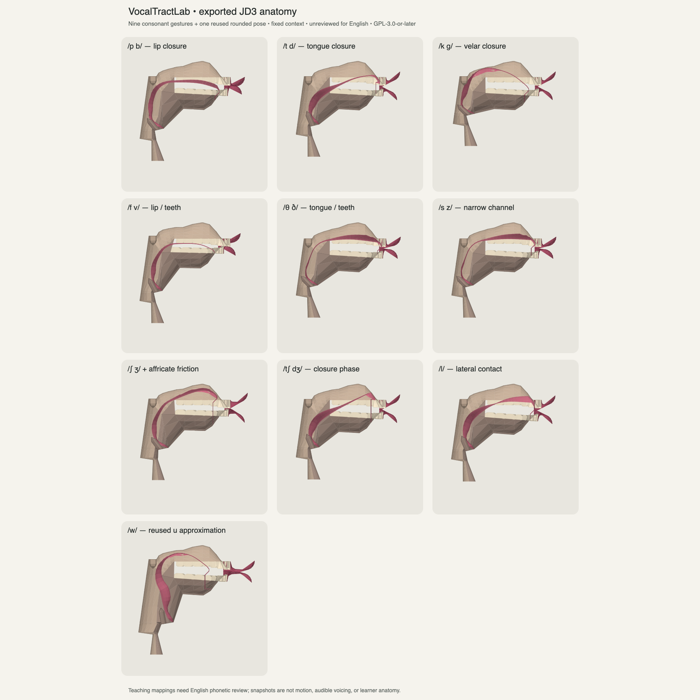

# Missing 3D asset coverage

Inventory was taken from main `7ae1f9f` and the open PR #1 on 28 October 2026.
Main already contained all **ten vowel meshes**, matching their packaged manifest.
The newer Speak catalog additionally selects **nineteen consonants**. Those
consonants had placement text, but no model mapping and no 3D tab. Missing
coverage was therefore a catalog/viewer gap, not ten absent vowel files or a
need for one GLB per word. Full-word transcriptions contain other phones; this
inventory concerns selected exercise targets, not a whole-word animation system.

This change uses the existing cross-platform VocalTractLab pipeline and `.vtlm`
format, independently of PR #1's separate iOS sheep/ship GLB prototype. Nine source-gesture
files cover seventeen consonants, with /w/ reusing an existing mesh. Following
user approval, two additional authored files now illustrate bunched and tip-up
/r/ alternatives. All nineteen selected consonants have explicit, unreviewed
3D coverage; /w/ remains an approximation.

| Selected sound(s) | Mesh asset key(s) | Source / status |
| --- | --- | --- |
| /p b/ | bilabial-closure | `ll-labial-closure(a)`; lip closure only |
| /t d/ | alveolar-closure | `tt-alveolar-closure(a)`; tongue closure only |
| /k ɡ/ | velar-closure | `tb-velar-closure(a)`; back-tongue closure only |
| /f v/ | labiodental-fricative | `ll-dental-fricative(a)`; lower-lip gesture |
| /θ ð/ | dental-fricative | `tt-dental-fricative(a)`; tongue-tip gesture |
| /s z/ | alveolar-fricative | `tt-alveolar-fricative(a)` |
| /ʃ ʒ/ | postalveolar-fricative | `tt-postalveolar-fricative(a)` |
| /tʃ dʒ/ | postalveolar-closure → postalveolar-fricative | `tt-postalveolar-closure(a)` followed by the existing friction gesture; separate selectable snapshots |
| /l/ | alveolar-lateral | `tt-alveolar-lateral(a)`; context-dependent lateral snapshot |
| /w/ | goose (reused) | JD3 `u`; explicitly approximate rounded starting snapshot, not a /w/ trajectory |
| /r/ | rhotic-bunched, rhotic-tip-up | Two authored illustrative alternatives, not upstream presets or reviewed British targets; neither is obligatory |

Each new key corresponds to `files/vtl/<key>.vtlm` in Compose resources and a
matching export under `design/vocaltractlab-preview/meshes/`. The nine source additions
and the two later /r/ additions are 156,468 bytes each, with 1,811 vertices and 2,804
triangles per file. Each has eleven source surfaces, grouped into the renderer's
five existing part categories. The original ten vowel files retain their bytes
and hashes. Voicing-pair reuse avoids duplicate assets and cached meshes;
/w/ likewise shares the existing `goose` cache entry.

## Educational and provenance limits

The geometry comes from the unchanged, pinned VocalTractLab backend and JD3
speaker, revision `df30392f18dc5e175b577c3ba734caaa65a3927f`. The source archive,
speaker, exporter, generation scripts, full GPL license and notice continue to
ship with the assets. The manifest records the nine source-preset names, their
fixed `a` context, all nineteen input parameters, and source/file hashes.

The [IPA chart](https://www.internationalphoneticassociation.org/sites/default/files/IPA_Kiel_2015.pdf)
provides the broad place/manner/voicing categories used in the mapping. It does
not validate these particular meshes as English targets. Existing app placement
cues are retained. All new consonant mappings are explicitly **unreviewed English
teaching snapshots**. The source context is fixed, not fitted to each example
word. No glottal geometry is exported, so voicing pairs share a mouth shape and
use text/audio for the distinction. Stop release, airflow and timing are not
rendered. Affricate closure and friction can be inspected separately; selecting
a phase is not speech animation or audio synchronization. The /w/ approximation
is labeled as reuse of `u`, not an exact labial-velar approximant reconstruction.

**Review gate:** a phonetics specialist should inspect contact/constriction,
clearance, tongue/lip placement, context dependence and agreement with the app's
teaching cues before removing the unreviewed label. The source contains no
English rhotic preset; inventing a bunched or curled-tip /r/ and calling it an
upstream target would misrepresent provenance. /r/ remains unavailable until an
explicit illustrative design or reviewed source is chosen. No scientific,
clinical, anatomical or pronunciation-accuracy validation is claimed.

## Generation and integration

Extract the bundled pinned source into a local build directory, then run:

```sh
bash scripts/vtl/regenerate.sh build/vtl-source --consonants-only
```

The script refuses modified upstream inputs. The consonants-only mode writes
new source gestures while leaving the existing vowel exports untouched.
`package_assets.py` copies all nineteen files and supporting source/notices into
Compose resources and hashes them. `consonant-poses.json` records the source
parameters; its contents are also embedded in the packaged manifest.

`ConsonantModelReferences` maps phonemes to shared files and phases.
`VocalTractLabMeshes.loadConsonant` uses the same bounded decoder and filename
cache as vowels. `OralCavityReferenceCard` exposes phase controls, descriptions,
front/side/cutaway, rotation and zoom, and rejects stale phoneme/phase results
while loading. Unmatched or failed resources retain guidance. Speak exposes the
3D tab for consonants without a vowel Sound map or vowel-formant comparison.
Scoring, progress persistence and audio operations are unchanged.

## Render evidence and verification

The contact sheet below is projected from the actual exported vertices. It is a
geometry review artifact, not a native device screenshot or phonetic validation.
Actual JVM Compose renderer checks separately write front/side screenshots for
all unique gestures, affricate phases, both /r/ variants and unsupported fallback to
`composeApp/build/reports/consonant-models/`.



Applicable checks include manifest/file hashes and original vowel preservation,
all mapped resources, sharing across voicing pairs, distinct affricate phases,
finite geometry, source provenance, unsupported sounds/phase indices, actual
Compose rendering, rapid target/phase switching, recording independence and
existing selection/audio/scoring/progress regressions. Final run results and
blocked device/CI checks are recorded in the draft PR.

### Original nine-gesture delivery — 28 October 2026

- Final targeted resource/model/selection/render suite: **21 passed**. Actual
  Compose pixels were inspected for the source-geometry sheet and app views,
  including closure and friction phases. This is JVM rendering, not a device run.
- Broader JVM suite: **218 run, 196 passed, 20 failed, 2 skipped**. The failures
  are persistence tests starting with the resolved SQLite 2.7.1 library's
  `Cannot find a suitable SQLite binary for mac os x | x86_64`, followed by
  initializer/time-out failures. No persistence implementation or production
  dependency was changed. The two opt-in physical microphone/local-service
  checks were not enabled. The full persistence suite needs a compatible host.
- Android host tests: **143 passed**. Android library and ARM64 iOS device and
  simulator Kotlin compilations passed separately.
- Unsigned generic iOS ARM64 app build: **BUILD SUCCEEDED** in fresh DerivedData.
  All nineteen bundled meshes byte-match the source manifest, and source/license
  resources are present. Reusing the earlier PR1 DerivedData initially produced
  a stale resource-copy error; a clean build directory resolved it without
  adding that separate prototype to this branch.
- No iPhone was connected. This Intel host cannot execute the app's ARM64
  simulator target. Native/device visual, touch, accessibility and performance
  checks remain open. No installation, merge, deployment or release occurred.
- At this delivery stage /r/ was pending. The subsequent user-approved additions
  are documented below. All English teaching mappings still need specialist
  review before their unreviewed label can be removed.

### Approved /r/ and appearance follow-up

See [the design, chosen parameters and native before/after review](RHOTIC_AND_ANATOMY_REVIEW.md).
The two authored /r/ variants increase the package to **21 distinct meshes**.
All nineteen earlier mesh files retain their original bytes. The native renderer
now provides a reversible sagittal tongue fill and softer diffuse shading;
the fill is illustrative, not a measured internal anatomical volume. No broad
anatomical mesh regeneration has been performed. Current verification results
and remaining native/specialist review limits are recorded in that review and PR.
