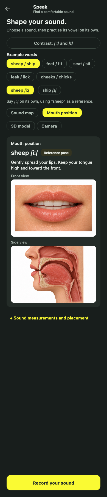

# iOS mouth-position prototype

The Speak screen keeps Sound map as the default. Mouth position offers an
Illustration / 3D prototype choice on iOS for **sheep /iː/** and **ship /ɪ/** only.
The existing native word/phoneme target selectors drive both representations. Native
Front, Side, Reset view, tissue opacity, and Listen controls are outside the web
view. Listen reuses the bundled whole-word WAV files through the practice component's
existing busy/recording/lifecycle arbitration; it does not animate speech. Pending
loads and playback cancel on stop/destroy and never save practice progress.
Illustration remains available on every platform. Other words and phonemes,
VoiceOver, viewer errors, process termination, and a missing ready handshake use
the existing image/text fallback. Recording and Sound map do not feed the model.

## Provenance and teaching scope

The source is the user-provided `vocal-tract-study.zip`, Library item
`libfile_84586ca5915481918bf2c7d9dd3f0e0b`, version 1. Complete model and Three.js MIT notices are embedded in the shipped
viewer HTML as well as retained with its sources. Its version-2 GLB is
5,527,848 bytes, with 65 meshes and no animation clips. The original MIT model
license and Three.js license are retained in `scripts/mouth-position/`.
The original Blender source and generator remain in the supplied ZIP; the app
needs only the generated, embedded model. The source rendered preview was
visually inspected during implementation. This is not live WebGL verification.

`poses.mjs` authors two distinct teaching references. They do **not** rename the
source viewer's illustrative A/I/U/Curl presets as reviewed IPA targets.

| Reference | Tongue raise | Advance | Tip raise | Jaw | Lip round |
| --- | ---: | ---: | ---: | ---: | ---: |
| sheep /iː/ | 0.72 | 0.78 | 0 | 0.12 | 0 |
| ship /ɪ/ | 0.42 | 0.48 | 0 | 0.24 | 0 |

These unitless weights are artistic controls, not measured articulator positions
or acoustic targets. Sheep places the tongue higher and farther forward than
ship, with a smaller jaw opening; both are unrounded. The tip is not curled.
The placement text and descriptions reuse `MouthPositionReferences`, retaining
the app's British-English phonemic conventions. The
[International Phonetic Association vowel chart](https://www.internationalphoneticassociation.org/content/ipa-chart)
provides the relative height/frontness/rounding framework; the
[BBC British-English symbol sheet](https://downloads.bbc.co.uk/learningenglish/features/themed_weeks/day_2_5_days_to_improve_your_pronunciation.pdf)
provides the app's phonemic-label context. These sources inform the teaching
intent; they do not validate this geometry or its numeric weights.

**Phonetic review gate:** neither model nor poses has independent specialist
validation. Before expanding beyond this pair or removing the prototype label,
a British-English phonetics specialist must inspect both rendered views and the
transition, tongue/palate clearance, tip placement, jaw/teeth/lip relationships,
and agreement with the cues and bundled audio. Record reviewer, date, dialect,
findings, and any changed weights. A static vowel reference does not encode
coarticulation, individual anatomy, or the possible dynamic realization of
FLEECE. F1/F2 cannot determine a learner's visible tongue pose here.

## Offline architecture and lifecycle

The generated `iosApp/iosApp/MouthPosition/mouth-position.html` contains pinned
Three.js 0.180.0 and the GLB bytes. No CDN, local server, account, upload, or
recording bridge is needed. `MouthWebSession` loads the bundled file once per
viewport. Compose recomposition sends state, not a new document.

The version-1 typed bridge accepts only sheep/ship, front/side, bounded opacity,
active state, and reduced-motion preference, plus disposal. A ready handshake
follows model setup and the first render; native code queues only the latest
selection until then. JS error, native navigation/process failure, or a 12-second
readiness timeout returns to illustrations. Navigation is restricted to the
single bundled document, capture permission is denied, and CSP permits only local
`blob:` fetches for embedded texture decoding. HTTP(S), external scripts, frames,
forms, and objects remain prohibited. All required textures must have decoded
images before ready; a loader result containing null/missing images fails into
the illustration fallback instead of displaying incomplete materials. The WK store is
nonpersistent. Microphone samples never enter JavaScript.

Only dirty frames and short 220 ms pose transitions request animation frames.
Idle poses have no continuous render loop. Reduced Motion applies the final
pose immediately. Native foreground notifications and clipped layout visibility
pause rendering; page visibility provides an additional stop. Disposal removes
notifications, web message handlers, DOM listeners, resize observation, pending
animation frames, geometry, textures, decoded ImageBitmap images, materials, and the renderer/context.
Image objects shared by textures are deduplicated before calling `close()` where
supported. A close-spy regression verifies deterministic cleanup; it is not a
measurement of native memory leakage. Late
loads cannot revive a disposed JS session. Capture buffers are disabled and
pixel ratio is capped at 2.

`window.mouthPositionDiagnostics()` exposes render count, geometry/texture
counts, current weights, and lifecycle state for local QA. No frame-rate claim
is made. On a compatible device, profile load time, main-thread work, GPU/frame
time, memory across repeated navigation, and idle/background rendering before
choosing further optimizations.

## Reproduction and verification

From the repository root:

```sh
cd scripts/mouth-position
npm ci --no-audit --no-fund
node build.mjs
node test.mjs
node test-lifecycle.mjs
```

The generated HTML is checked in so normal app builds need no Node or network
viewer dependency. Regenerate it after changing viewer code, weights, or model.
The geometry test checks the actual GLB, 65 meshes, required tongue morphs,
distinct poses, finite geometry at 21 transition steps, broad model bounds,
and embedded/offline packaging. Bounds checks are not anatomical collision
certification. The DOM lifecycle test uses explicit renderer/model-load doubles;
it tests readiness, rapid selection, idle frames, pause/resume, reduced motion,
unsupported state and disposal across ten sessions. It does **not** test WebGL.

On macOS, the separate native WebKit test uses the actual GLB and unmodified
Three.js GLTFLoader/ImageBitmapLoader path under enforced CSP. It decodes all ten
embedded PNGs as ImageBitmaps with the shipped blob-only policy, reproduces their
failure with the old connect-none policy, and observes CSP blocking an HTTPS
probe. It uses in-memory HTML, without browser/file navigation, a server, or a
WebGL renderer. This verifies texture decoding and CSP, not iOS rendering:

```sh
node scripts/mouth-position/build-texture-tests.mjs /tmp/minimalpairs-texture-fixtures
MOUTH_TEXTURE_FIXTURES=/tmp/minimalpairs-texture-fixtures swift test \
  --package-path scripts/mouth-position/native-texture-tests
```

```sh
./gradlew :composeApp:jvmTest :composeApp:compileKotlinIosArm64 \
  :composeApp:compileKotlinIosSimulatorArm64 --max-workers=1 --no-parallel
```

JVM tests cover the scoring regression, bridge queue/disposal, unsupported poses,
existing image/resource coverage, and existing Speak/Sound map/recording UI flows.
At the original 99b3bc9 baseline, the regression was observed failing for both the selected-IPA label and
identical scores across A/B before the fix. Current main subsequently changed Speak to pass selected example words and
added scoring provenance/transport validation. Those changes are retained. Local
scoring still supports generic sustained-vowel callers and now uses an exact
selected IPA first, then known whole-word lookup. An unknown word no longer
silently chooses phoneme 2. Whole-word transcripts keep their word lookup.

### Runtime review still required

This connected Mac is Intel with Xcode 16.0 and iOS 18.0 simulator runtimes.
Compose 1.12.2 does not publish an Intel iOS variant; the project's supported
simulator target is ARM64. No physical iPhone was connected during verification.
The attempted Intel simulator configuration was removed. Browser local-file
preview was blocked by browser URL policy and was not bypassed.

On a supported ARM simulator, then a real iPhone, verify actual rendered pixels
for both poses/views; rapid A/B changes before and after ready; reset/opacity;
repeated entry/exit; scroll offscreen; background/resume; VoiceOver and enlarged
text; Reduced Motion changes; bundled word playback; microphone flow remaining
independent; offline loading; missing/corrupt model and WebGL/context/process
failure returning to illustrations. The unsigned local ARM64 app build confirms that `mouth-position.html` is
packaged at the bundle root. Confirm the WK ready/error handshake on device. Until then, live rendering,
performance, native lifecycle behavior and device accessibility remain open
review gates despite unit/compile checks.

## Current-main integration — 27 October 2026

The feature branch incorporates main `03fc592` (26 commits beyond the original
base), including durable progress queues/backups/history, component stop/destroy
cleanup and target locks, whole-word scoring calls and provenance, VocalTractLab
references, and Camera. Existing progress/store/database and host-lifecycle
sources are unchanged relative to that main revision. Reference-word playback
adds to the existing component operation/cleanup path rather than maintaining a
second UI-owned player. The optional WK prototype remains within Mouth position;
it does not replace the existing 3D model or Camera tabs.

The scoring regression compares the selected-IPA route with the independent
known-word lookup route using a full transcript, in both targets of every
contrast. It also verifies different scores for the same PCM against different
targets and preserves explicit whole-word/unknown-word behavior.

Integrated verification results follow; the earlier 51-test report is superseded. Live iOS
WebGL, device performance/accessibility, and specialist phonetic review remain
open regardless of compile and texture-unit results.

| Integrated check | Result |
| --- | --- |
| JVM suite | 191 run: 172 passed, 19 persistence failures caused by unavailable Intel Mac SQLite native binary |
| Android host tests | 134 passed |
| Android library compilation | Passed |
| iOS ARM64 device/simulator Kotlin compilation | Passed; compilation only |
| Unsigned generic iOS ARM64 app build | Passed; packaged HTML byte-matches the generated viewer and contains the blob-only CSP and complete MIT notices |
| Backend API tests | 32 passed |
| Calibration-report helper | 3 tests and 6 subtests passed |
| Actual native WebKit texture/CSP tests | 2 passed; all 10 PNGs decoded with blob-only CSP, old CSP failure reproduced, HTTPS probe blocked by CSP |
| GLB geometry/package checks | Passed; zero validator errors/warnings, 65 meshes, 21 transition steps, complete shipped notices |
| DOM lifecycle tests | Passed using renderer/load doubles, including missing-texture failure and shared bitmap close spy |

The resolved `androidx.sqlite:sqlite-bundled-jvm:2.7.1` JAR contains Linux x64/ARM64,
Windows x64 and macOS ARM64 natives, but no `natives/osx_x64` entry. The first
persistence failure is `Cannot find a suitable SQLite binary for mac os x |
x86_64`, followed by initializer failures/timeouts. Production dependency
versions were not downgraded and persistence tests were not disabled. These 19
checks need a compatible host/runtime before the full JVM suite can be declared
green. Progress implementation files remain byte-for-byte unchanged from the
integrated main revision.

The following JVM screenshot verifies retained selection, illustration fallback,
independent 3D model/Camera tabs, and the pinned recording control. It is **not**
an iOS screenshot or evidence of live prototype WebGL rendering.


