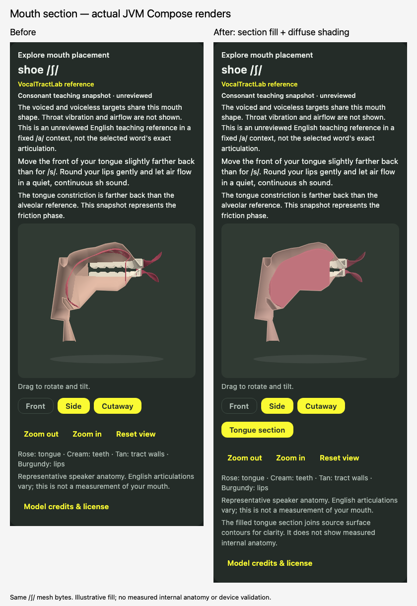
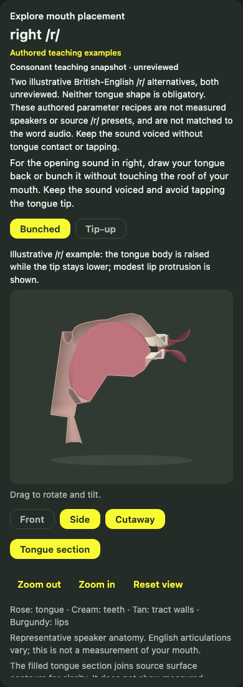
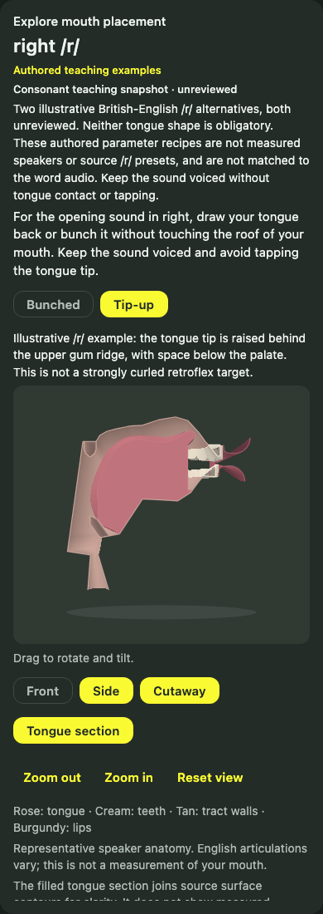

# /r/ alternatives and section-rendering review

The user requested both labelled /r/ alternatives and a more natural anatomical
appearance. These changes extend draft PR #2; they do not change the scoring
contract, target accent, recordings, progress or audio arbitration.

## Two authored /r/ examples

The app's documented contract remains broad British English with public /r/
mapped to scoring token [ɹ]. The existing catalog's “American /r/” cue and the
word generator's American tutor configuration are inconsistent with that broad
contract. They are recorded here rather than silently changing audio or scoring.
No tongue shape is inferred from the recordings or learner acoustics.

The pinned JD3 speaker has no English approximant /r/ preset. In particular, the
source uvular fricative is not repurposed as English /r/. Both new poses are
explicitly authored parameter recipes in the existing JD3 anatomy, not measured
British speaker targets. They are labelled **illustrative / unreviewed**.

Qualitative references:

- Strycharczuk, Lloyd & Scobbie (2023), [Apparent time change in the articulation
  of onset rhotics in Southern British English](https://www.internationalphoneticassociation.org/icphs-proceedings/ICPhS2023/full_papers/315.pdf),
  especially Figure 2: British speakers show several tip-up and bunched variants.
  The figure's tongue contours were inspected locally, without redistributing
  its artwork. The study does not supply JD3 parameters or validate these meshes.
- Lawson's [Dynamic Dialects /r/ resource](https://dynamicdialects.ac.uk/r-and-l-in-english/?type=r)
  distinguishes a raised tip/blade without retroflexion from a curled retroflex
  tongue. Tip-up is therefore not labelled “retroflex” in this app.
- Birkholz (2013), [Modeling consonant-vowel coarticulation for articulatory
  speech synthesis](https://doi.org/10.1371/journal.pone.0060603), describes the
  tongue body/tip, blade/root, lip and jaw controls. Its modeled German uvular
  /r/ is not evidence for an English /r/ target.

`rhotic-bunched.vtlm` raises the tongue body while keeping the anterior tip
lower. `rhotic-tip-up.vtlm` raises the tip while leaving the body lower, without
a strongly curled target. Both retain a closed velic port, an open oral
approximant constriction, modest lip protrusion and the same jaw opening.
Neither is obligatory, a preferred learner shape, a complete inventory of
British variants, or synchronized with reference-word audio.

### Chosen controls

These numbers are authoring choices, **not values measured in the cited studies**.
Coordinates/protrusion/distances use source centimetres; JA uses degrees; side
and velum controls use the source parameter definitions. All nineteen requested
and effective values after upstream limits are in
`design/vocaltractlab-preview/meshes/rhotic-poses.json`, copied into the bundled
manifest as `rhotic_teaching_poses`.

| Controls | Bunched | Tip-up | Intended illustration |
| --- | --- | --- | --- |
| TCX / TCY | 1.00 / -0.90 | 0.70 / -1.50 | Higher body in bunched example |
| TTX / TTY | 4.00 / -1.15 | 3.70 / 0.65 | Lower vs raised tip |
| TBX / TBY | 2.80 / 0.60 | 2.40 / 0.00 | Different blade contours |
| TRX / TRY | -2.20 / -3.00 | -2.20 / -3.00 | Explicit root controls; automatic root disabled for these two exports only |
| LP / LD | 0.30 / 0.70 | 0.20 / 0.70 | Modest protrusion; same open lip distance |
| HX / HY | 0.70 / -5.10 | 0.70 / -5.10 | Same hyoid/larynx setting |
| JX / JA | 0 / -3 | 0 / -3 | Same jaw translation/angle |
| VS / VO | 0.60 / -0.10 | 0.60 / -0.10 | Same velum setting; closed port |
| TS1 / TS2 / TS3 | 0.20 / 0.25 / 0.15 | 0.20 / 0.25 / 0.15 | Same illustrative lateral elevation |

The geometry checks independently sample sagittal mesh contours, checking the
higher bunched body, higher tip-up anterior tongue, and visible oral air gaps.
Those checks prevent simple geometric mistakes; they do not establish acoustic
/r/ identity, full three-dimensional airflow, muscle physiology or phonetic
validity. Specialist review must assess constriction locations, tongue-root and
lateral shaping, lips, English suitability and teaching cues before removing
“unreviewed”. Matching a specific recording would require articulatory evidence
from that speaker, not sound alone.

## Why the previous view looked artificial

Inspection of actual native JVM pixels, the exported surfaces and the model's
anatomical/control descriptions found:

- The exporter contains a tongue **surface**, not a closed muscle volume. A
  sagittal cut therefore exposed a narrow rose ribbon, making the tongue look
  hollow or absent beneath its dorsal contour.
- The walls and tooth rails are coarse parametric surfaces; a wall is not a
  complete skull or mandible. Individual tooth crowns/roots, gingival detail,
  facial skin, tongue underside/muscles and detailed lip volume are absent.
- The former absolute-value directional light lit both surface orientations,
  producing bright rims; the palette and plain cut edges reinforced a plastic
  or schematic appearance.

Birkholz's anatomical model description explicitly uses simplified parametric
surfaces and an estimated jaw rotation mechanism. Aesthetic softening does not
make these surfaces a clinical reconstruction.

### Scoped appearance change and preview

The new optional **Tongue section** fills the sagittal tongue contour down to
the source lower-cover contour. It triangulates a display-only section without
moving any source vertex. It is not an inferred muscle volume or a new external
tongue surface. Unknown/disconnected/untriangulable contours omit the fill;
the original surface view remains available. The fill appears only in cutaway
views, with accessible state text. Softer diffuse shading and muted tissue
colours reduce the plastic rim effect.



The comparison uses the **same /ʃ/ asset bytes** in both panels. No photorealistic
image was substituted for rendered geometry. All nineteen pre-existing meshes,
including all ten vowels, remain byte-identical. Only the two approved /r/
meshes are added. No broad anatomical regeneration has taken place. Review this
preview before undertaking a redesign of lips, individual teeth, jaw, palate or
closed tongue anatomy across the inventory. That larger change needs an
appropriate anatomical source and a separate contour/phonetic preservation review.

The app renders on demand; there is no animation loop. Section triangulation is
remembered per mesh, cutaway state and side, rather than repeated for every drag
angle. It adds fewer than 200 triangles to each 2,804-triangle source mesh.
The test output records host timings; these are not device frame-rate claims.

## Reproduction and validation

```sh
bash scripts/vtl/regenerate.sh build/vtl-source --r-only
python3 scripts/vtl/render_preview.py --r-only
```

`build/vtl-source` must be an unchanged extraction of the bundled pinned archive;
`regenerate.sh` verifies it first. `--r-only` preserves existing consonant and
vowel files. The exporter, original speaker/archive, full GPL notice and source
continue to ship. `rhotic-preview.svg` shows raw exported surfaces; native JVM
screenshots in `composeApp/build/reports/consonant-models/` show the actual fill,
controls and both views. `scripts/vtl/compose_review.swift` assembles the labelled
before/after screenshot sheet without retouching geometry.

Follow-up verification on 28 October 2026:

- **43 targeted JVM checks passed**: actual Compose views for both /r/ variants,
  rapid selection/variant switching, recording independence, unsupported fallback,
  all resources/hashes, distinct tongue shapes and oral air gaps, section fill,
  audio/scoring contracts, host lifecycle and non-database progress logic.
- **144 Android host tests passed**. Android library and both ARM64 iOS device
  and simulator Kotlin compilation checks passed.
- Local unsigned generic iOS ARM64 app build: **BUILD SUCCEEDED**. All 21
  bundled mesh hashes and required source/license resources were verified.
  Initial Xcode invocation lacked Java; supplying the installed Java 17 path
  resolved it without a repository configuration change or installation.
- All 21 asset files match their manifest and source exports; all nineteen
  previous assets retain their prior hashes. Bundled source/scripts/notices match.
- Sagittal-fill construction averaged **1.22 ms** over 20 iterations on this
  JVM host in the final targeted run. It is remembered between view rotations;
  no device draw timing or frame rate was measured.
- A broader initial selection also ran three `ProgressDeltaTest` database tests;
  all three failed on the already-documented SQLite 2.7.1 missing Intel Mac binary.
  They were not fixed or represented as passing. The earlier full-suite result
  remains recorded in `CONSONANT_3D_ASSETS.md`; no full-suite pass is claimed.

No iPhone is connected; this
Intel Mac cannot run the project's ARM64 iOS simulator target. Device visual,
touch, VoiceOver, background/resume and performance validation remain open.


Native JVM examples (illustrative / unreviewed):



